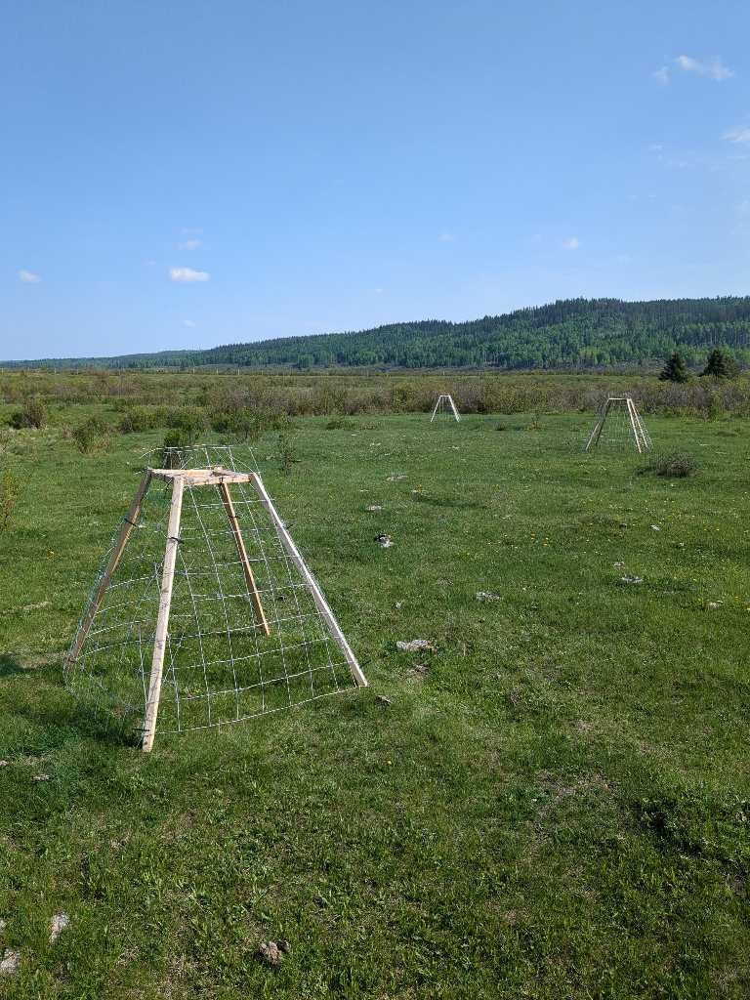

```{r setup, include=FALSE}
knitr::opts_chunk$set(
  echo = TRUE, warning = FALSE, message = FALSE,
  fig.width = 10, fig.height = 6, dpi = 150,
  cache = FALSE
)
```

```{css, echo=FALSE}
p.caption {
  text-align: justify;
}
```

## Overview

PlanetScope-derived NDVI is used as the primary index of herbaceous forage availability throughout the main analysis. This appendix tests satellite NDVI against ground-truth aboveground herbaceous biomass collected from grazing exclosures deployed across the study area. We present: (1) the exclosure sampling design and biomass collection protocol, (2) a comparison of ungrazed forage biomass across land cover types in spring and summer, and (3) the NDVI-biomass relationship by land cover type, demonstrating that satellite NDVI is a reasonable proxy for herbaceous biomass on herbaceous land cover, but not on shrub and wetland land cover.  

## Exclosure Sampling Design

Portable wire grazing exclosures (1.2 m x 1.2 m) were deployed at 20 camera trap locations spanning three land cover types: herbaceous meadows (n = 11), shrublands (n = 4), and wetlands (n = 5). Four exclosures were placed at each location, positioned to capture representative vegetation conditions. Exclosures were deployed in 2023 and 2024 and left in place until 2025. After each clipping event, exclosures were relocated within the same site to avoid repeat sampling of the same quadrat. 

Aboveground herbaceous biomass (live grass and forb material) was harvested by clipping at ground level within each exclosure. In 2023-2024, a 0.5 m² quadrat was clipped per exclosure; in 2025, the clipping area was reduced to 0.25 m² so that we could sample the exclosure in spring (June) as well as summer (August). All clipped material was sorted to remove litter and woody stems, dried at 50 C for 5 days, and weighed to the nearest 0.1 g. Biomass values were expressed as g/m².

Summer biomass was collected once annually at peak standing crop (late July-August) in 2023, 2024, and 2025. An additional spring collection was conducted in June 2025 to characterise early-season forage conditions.

Because the same locations were sampled in successive years, clipping events within a location are not independent. The relationship estimated here is a validation of the NDVI proxy and is not a component of the habitat models, so no correction propagates into them.

```{r exclosure-photo, fig.cap = "**Figure S2.1.** A portable wood and wire grazing exclosure (1.2 m × 1.2 m) deployed at a camera trap site on herbaceous land cover, Ghost PLUZ, Alberta. Four exclosures were positioned per camera location to capture representative vegetation conditions.", fig.align = "center", out.width = "70%", echo = FALSE}


```

## Setup

```{r libraries}
library(tidyverse)
library(broom)
library(knitr)
library(kableExtra)

theme_set(theme_bw(base_size = 12))
```

```{r load-data}
# Biomass data: one row per location x veg_type x year
biomass <- read_csv("input/all_exclosure_data_by_year.csv", show_col_types = FALSE)

# Site metadata with monthly NDVI from PlanetScope
sites <- read_csv("input/exclosure_sites.csv", show_col_types = FALSE)

# 8-band python workflow NDVI zonal statistics
ndvi23 <- read_csv("input/exclosure_ndvi_2023.csv", show_col_types = FALSE)
ndvi24 <- read_csv("input/exclosure_ndvi_2024.csv", show_col_types = FALSE)
```

```{r prepare-data}
# Classify seasons:
# "2025_spring" = Spring (June collection); all others = Summer (Jul-Aug collection)
grassforb <- biomass %>%
  filter(veg_type == "grassforb") %>%
  mutate(
    location_upper = toupper(location),
    season = if_else(year == "2025_spring", "Spring", "Summer")
  )

# Join strata from sites
sites_lookup <- sites %>%
  mutate(location_upper = toupper(location)) %>%
  select(location_upper, strata, starts_with("NDVI_monthly"))

grassforb_strata <- grassforb %>%
  left_join(sites_lookup, by = "location_upper") %>%
  filter(!is.na(strata)) %>%
  mutate(
    strata = factor(strata,
                    levels = c("herb", "shrub", "wetland"),
                    labels = c("Herbaceous", "Shrub", "Wetland"))
  )
```

## Forage Biomass by land cover Type and Season

Ungrazed (exclosure-protected) herbaceous biomass was compared across the three land cover types and two seasons. Spring biomass represents early-season conditions (June 2025), while summer biomass reflects peak standing crop pooled across 2023-2025.

```{r biomass-barplot, fig.height=5, fig.cap="**Figure S2.2.** Ungrazed herbaceous biomass (g m²) by land cover type and season. Bars show means; error bars show ±1 SD. Spring = June 2025; Summer = peak standing crop pooled across 2023–2025."}
# Summarise mean +/- SD of ungrazed biomass (g_per_m2_IN)
biomass_summary <- grassforb_strata %>%
  group_by(strata, season) %>%
  summarise(
    n = n(),
    mean_biomass = mean(g_per_m2_IN, na.rm = TRUE),
    sd_biomass = sd(g_per_m2_IN, na.rm = TRUE),
    .groups = "drop"
  ) %>%
  mutate(season = factor(season, levels = c("Spring", "Summer")))

ggplot(biomass_summary, aes(x = strata, y = mean_biomass, fill = season)) +
  geom_col(position = position_dodge(width = 0.7), width = 0.6) +
  geom_errorbar(
    aes(ymin = mean_biomass - sd_biomass, ymax = mean_biomass + sd_biomass),
    position = position_dodge(width = 0.7), width = 0.2
  ) +
  scale_fill_manual(values = c("Spring" = "#5B9BD5", "Summer" = "#ED7D31")) +
  labs(
    title = "Forage Biomass Comparison by land cover Type",
    x = NULL,
    y = expression("Ungrazed herbaceous biomass (g/m"^2*")"),
    fill = "Season"
  ) +
  theme(
    legend.position = "right",
    axis.text.x = element_text(size = 12)
  )
```

```{r biomass-table}
kable(biomass_summary,
      digits = 1,
      caption = "Ungrazed herbaceous biomass (g/m²) by land cover type and season.",
      col.names = c("land cover", "Season", "N", "Mean", "SD")) %>%
  kable_styling(bootstrap_options = c("striped", "hover"), full_width = FALSE)
```

Herbaceous meadows support the highest forage biomass in both seasons, consistent with their open canopy and dominance by graminoids and forbs. Shrubland and wetland sites show lower herbaceous biomass, reflecting woody canopy shading and different plant community composition, respectively.

## NDVI-Biomass Relationship

To test PlanetScope NDVI as a proxy for herbaceous forage availability, each biomass clipping was matched to the NDVI at its collection time and location, extracted within a 50 m buffer around each exclosure site. Exclosure locations were recorded to a GPS accuracy of approximately ±10 m. However, because biomass clippings were collected in 2025 (summer and spring) but 2025 PlanetScope was not available to us, we used the average of the 2023 and 2024 NDVI composites at each site as the best available estimate for spring (June) and summer (August).

```{r ndvi-biomass-join}
# Match each biomass clipping to NDVI at its collection time and location.
# 2023 and 2024 clippings use same-year August NDVI directly.
# 2025 imagery not yet processed, so 2025 clippings use the mean of
# 2023 + 2024 composites as the best available estimate.

ndvi_biomass <- grassforb_strata %>%
  mutate(
    ndvi = case_when(
      year == "2023"        ~ NDVI_monthly_2023_August,
      year == "2024"        ~ NDVI_monthly_2024_August,
      year == "2025"        ~ (NDVI_monthly_2023_August + NDVI_monthly_2024_August) / 2,
      year == "2025_spring" ~ (NDVI_monthly_2023_June + NDVI_monthly_2024_June) / 2
    )
  ) %>%
  filter(!is.na(ndvi), !is.na(g_per_m2_IN))
```

```{r ndvi-scatter, fig.height=5, fig.cap="**Figure S2.3.** NDVI–biomass relationship by land cover type. Each point represents one exclosure sampling event (4 exclosures); dashed lines are ordinary least squares fits with 95% confidence intervals. NDVI was matched to same-year PlanetScope composites for 2023 and 2024 clippings; 2025 clippings used the mean of 2023 and 2024 composites (2025 imagery not available)."}
# Fit R-squared and p-value per land cover type
model_stats <- ndvi_biomass %>%
  group_by(strata) %>%
  summarise(
    n = n(),
    r2 = summary(lm(ndvi ~ g_per_m2_IN))$r.squared,
    p_value = summary(lm(ndvi ~ g_per_m2_IN))$coefficients[2, 4],
    .groups = "drop"
  ) %>%
  mutate(
    label = paste0(
      "R\u00B2 = ", sprintf("%.3f", r2), "\n",
      if_else(p_value < 0.001, "p < 0.001", paste0("p = ", sprintf("%.2f", p_value)))
    )
  )

ggplot(ndvi_biomass, aes(x = g_per_m2_IN, y = ndvi)) +
  geom_point(aes(color = season), size = 3, alpha = 0.7) +
  geom_smooth(method = "lm", se = TRUE, color = "black", linetype = "dashed") +
  geom_text(
    data = model_stats,
    aes(x = Inf, y = -Inf, label = label),
    hjust = 1.1, vjust = -0.3, size = 3.5, inherit.aes = FALSE
  ) +
  facet_wrap(~ strata, scales = "free") +
  scale_color_manual(values = c("Spring" = "#70AD47", "Summer" = "#ED7D31")) +
  labs(
    title = "NDVI-Biomass Relationship by land cover Type",
    x = expression("Herbaceous biomass (g/m"^2*")"),
    y = "NDVI",
    color = "Season"
  ) +
  theme(
    strip.text = element_text(face = "bold", size = 11),
    legend.position = "right"
  )
```

```{r ndvi-model-table}
kable(model_stats %>% select(strata, n, r2, p_value),
      digits = c(0, 0, 3, 4),
      caption = "Linear model fit (NDVI ~ biomass) by land cover type.",
      col.names = c("land cover", "N", "R\u00B2", "p-value")) %>%
  kable_styling(bootstrap_options = c("striped", "hover"), full_width = FALSE)
```

## Conclusion

Satellite NDVI shows a reasonable and significant positive association with ground-truth herbaceous biomass on herbaceous land cover, but not on shrub and wetland land cover. The NDVI-biomass relationship on herbaceous land cover was not used to extrapolate biomass estimates across the landscape, but to justify the use of NDVI as a reasonable proxy for herbaceous forage availability and change throughout the growing season on herbaceous land cover. 


